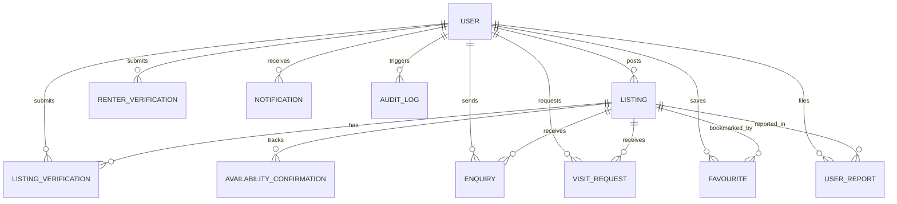

# Roomigo 🏠✨
> **Trusted Shared Accommodation & Replacement Flatmates Platform**  
> *Find your next room without the guesswork. Discover verified vacancies, connect with genuine flatmates, and eliminate rental scams.*

---

## 🎯 Executive Overview

**Roomigo** is a verified shared rental web application designed to solve one of the most stressful problems in urban tech hubs: **finding a replacement flatmate quickly when someone vacates mid-lease**, without wading through fake ads, expired posts, or unverified brokers.

Initially targeted at **Hyderabad’s IT corridors** (Madhapur, Gachibowli, Kondapur, HITEC City, Kukatpally, Financial District, and Gowlidoddy), Roomigo prioritizes:
1. **Replacement Flatmate Vacancies** (Tenants moving out mid-lease or remaining tenants seeking replacements)
2. **Available Rooms in Shared Flats** (Existing tenants offering an open room)
3. **Other Shared Accommodation Listings** (Twin/multi-sharing rooms)

Full independent apartment rentals are deliberately deferred to ensure maximum focus and quality on the shared living experience.

---

## ⚡ Core Value Propositions & Differentiators

| Feature | The Roomigo Differentiator |
| :--- | :--- |
| **7-Day Auto-Expiry Guarantee** | Every listing strictly expires in **7 days** unless reconfirmed by the poster with a single click. No outdated or ghost listings. |
| **Two-Sided Verification** | Both renters (Govt ID + Tech Work ID/College ID) and posters are verified before contact, building peer-to-peer trust. |
| **Tenancy Replacement Authority** | Unlike generic rental platforms, Roomigo **does not assume** current tenants have legal sublease or replacement rights. Posters must declare their relationship and submit lease or landlord NOC proof. |
| **Provider-Independent Phone OTP** | Abstracted SMS service interface (`SmsService`) with mock/live implementations for seamless migration between Twilio, AWS SNS, Msg91, or Fast2SMS. |
| **Privacy-First Safety Flow** | Exact apartment door numbers are hidden; approximate localities and verified landmarks are displayed. Users are reminded in plain language to **"Visit Before Paying"**. |
| **Real Database Admin Dashboard** | Metrics, audit logs, verification review queues, and report resolutions are 100% computed from real database tables (no mock or hardcoded statistics). |
| **Progressive Web App (PWA)** | Installable on iOS, Android, and Desktop with offline caching, responsive UI, and push notification readiness. |

---

## 🛠️ Technology Stack

### Frontend
- **Framework:** React 18 with TypeScript & Vite 5
- **Styling:** Tailwind CSS (Modern, mobile-first responsive layout)
- **Icons:** Lucide React
- **PWA:** Web App Manifest (`manifest.json`), Service Worker (`sw.js`) with cache-first and network fallback strategies
- **State Management:** React Context API (`AuthContext`, `NotificationContext`)
- **HTTP Client:** Axios with JWT interceptors

### Backend
- **Framework:** Spring Boot 3.3.4 (Java 17/21 compatible)
- **Security:** Spring Security 6 with stateless JWT authentication (`jjwt 0.12.6`), BCrypt password hashing, and role-based access control (`ROLE_RENTER`, `ROLE_POSTER`, `ROLE_ADMIN`)
- **Database Access:** Spring Data JPA with Hibernate 6
- **Database:** MySQL 8.0 with InnoDB engine, utf8mb4 charset, foreign keys, and indexes
- **Validation:** Jakarta Bean Validation (`@Valid`, `@NotBlank`, `@FutureOrPresent`, `@Min`)
- **Scheduling:** Spring `@Scheduled` cron jobs for automatic listing expiry after 7 days

---

## 🗄️ Database Architecture & Entities

The application schema consists of 12 well-defined relational entities:



### Key Entities:
1. **`User`**: Profiles for Renters, Posters, and Admins with verification badges (`phoneVerified`, `idVerified`, `verificationStatus`).
2. **`Listing`**: Vacancy details including `listingType`, `rentAmount`, `depositAmount`, `maintenanceAmount`, `utilitiesEstimate`, `flatmateVibe`, `houseRules`, `photos`, and `lastReconfirmedAt`.
3. **`ListingVerification`**: Poster relationship (`Current Tenant Moving Out`, `Remaining Flatmate Seeking Replacement`, `Master Tenant on Lease`), authority proof type (`Rental Agreement`, `Landlord NOC`), document URLs, admin checklist (approx location, rent, photos, rules), and admin review notes.
4. **`RenterVerification`**: Government ID and employment/college ID proofs for seekers.
5. **`AvailabilityConfirmation`**: 7-day reconfirmation timestamp audit trail.
6. **`Enquiry`**: Direct communication between prospective flatmates and listing posters with reply threading.
7. **`VisitRequest`**: In-person or video-call scheduling with time slots and status tracking (`PENDING`, `CONFIRMED`, `COMPLETED`, `CANCELLED`).
8. **`Favourite`**: User bookmarks for fast access.
9. **`UserReport`**: Flagging suspicious posts, scams, or inaccurate rent amounts with admin resolution workflows.
10. **`Notification`**: Real-time in-app alerts for submitted listings, admin approvals/rejections, enquiries, and visit bookings.
11. **`Locality`**: Supported IT corridor areas with average rent stats and descriptions.
12. **`AuditLog`**: Immutable history of administrative and critical user actions.

---

## 🚀 Quick Start Guide

### Prerequisites
- **Java 17 or higher** (`java -version`)
- **Node.js 18+ and npm** (`node -v`, `npm -v`)
- **MySQL 8.0 Server** running locally on port `3306`

### 1. Database Setup
Log into MySQL and ensure the database exists:
```sql
CREATE DATABASE IF NOT EXISTS roomigo_db CHARACTER SET utf8mb4 COLLATE utf8mb4_unicode_ci;
```

Update your database credentials in `backend/src/main/resources/application.yml` if different from default:
```yaml
spring:
  datasource:
    url: jdbc:mysql://localhost:3306/roomigo_db?useSSL=false&allowPublicKeyRetrieval=true&serverTimezone=Asia/Kolkata
    username: root
    password: YOUR_MYSQL_PASSWORD
```

### 2. Start Backend Server
```powershell
cd c:\Users\admin\Desktop\Roomigo\backend
mvn clean spring-boot:run
```
*The backend starts on `http://localhost:8080`. On initial boot, `DataInitializer` automatically seeds realistic Hyderabad IT corridor listings, demo users, verifications, and audit logs.*

### 3. Start Frontend Application
In a separate terminal:
```powershell
cd c:\Users\admin\Desktop\Roomigo\frontend
npm install
npm run dev
```
*The React application starts at `http://localhost:5173/`.*

---

## 👥 Demo Accounts (Pre-Seeded)

For immediate demonstration and evaluation, the database comes pre-loaded with active accounts with 1-click login buttons built into the Sign In dialog:

| Role | Email | Password | Persona & Privileges |
| :--- | :--- | :--- | :--- |
| **Admin** | `admin@roomigo.in` | `admin123` | Platform Administrator with access to `/admin` dashboard, verification queues, report disputes, and locality manager. |
| **Poster** | `rahul.sharma@roomigo.in` | `poster123` | Software Engineer at Microsoft IDC, Gachibowli seeking replacement flatmate. Has active listings on `/my-listings` with 1-click reconfirmation. |
| **Renter** | `ananya.sen@roomigo.in` | `renter123` | Product Designer at Google Hyderabad seeking verified private room near HITEC City/Kondapur. |

> **OTP Verification Demo Code:** Enter `123456` in any phone verification prompt to simulate real-time SMS delivery.

---

## 🧭 Walkthrough of Core Workflows

### 1. Discovering Vacancies (Search & Match)
- Navigate to `http://localhost:5173/search`.
- Filter by **Locality** (e.g. *Gachibowli*, *Kondapur*, *Financial District*), **Listing Type** (*Replacement Flatmate*), **Budget Slider** (₹5,000 to ₹35,000), **Gender Preference**, and **"Verified Listings Only"**.
- Every card shows a live **Reconfirmed Status Badge** (e.g., `"Reconfirmed 2 days ago • 5 days left"`).

### 2. Inspecting a Vacancy & Safety Guidance
- Click on any listing card (e.g., *DLF CyberCity Gachibowli*).
- Notice the prominent **Safety Banner**: *"Always inspect the shared flat in person or via live video before transferring token amounts."*
- View verified breakdown: Base Rent, Maintenance, Estimated Utilities, Flatmate Vibe, and House Rules.
- Click **"Schedule a Visit"** to request an in-person or video walkthrough.
- Click **"Send Enquiry"** to message the current tenant directly.

### 3. Posting a Vacancy (7-Step Wizard)
- Log in as Poster (`rahul.sharma@roomigo.in`) and click **"Post Vacancy"** in the top navigation.
- Step through the 7-step wizard:
  1. **Listing Type & Locality:** Replacement Flatmate / Available Room / Shared Accommodation.
  2. **Approximate Location:** Landmark, pincode (door number kept private).
  3. **Financials & Costs:** Rent, deposit, society maintenance, food arrangement.
  4. **Room & Flat Details:** BHK, private vs. shared room, washroom, furnishings.
  5. **Lifestyle & House Rules:** Current roommates, flatmate vibe, smoking/alcohol/guest rules.
  6. **Photos:** High-resolution image URLs.
  7. **Tenancy Replacement Authority:** Declaration of tenant relationship + lease agreement / landlord NOC proof submission.
- Once submitted, the listing enters `PENDING_VERIFICATION` and appears instantly in the Admin Queue.

### 4. 1-Click 7-Day Reconfirmation
- As a Poster, visit `http://localhost:5173/my-listings`.
- See the remaining days on each vacancy.
- Click the green **"Reconfirm Availability"** button. The backend updates `lastReconfirmedAt` and resets the 7-day countdown to keep the post fresh.

### 5. Admin Verification & Dispute Queue
- Log in as Admin (`admin@roomigo.in`) and navigate to `http://localhost:5173/admin`.
- View live database metrics: Total Listings, Active Listings, Pending Verifications, Reports, and Verified Seekers.
- Open the **"Listing Verifications"** tab.
- Click **"Review Tenancy Evidence"** on pending submissions to verify:
  - [x] Approximate location check
  - [x] Rent & deposit validation
  - [x] Real photos verification
  - [x] House rules sanity check
- Click **"Approve & Publish"** or **"Request Corrections"**. Approved listings automatically become live on the public feed and generate poster notifications!

---

## 🐳 Docker Deployment

The application includes full containerization support for local or production deployment.

### Run with Docker Compose
```bash
docker compose up -d --build
```

This starts:
- `roomigo-mysql`: MySQL 8.0 on port `3306` with healthcheck
- `roomigo-backend`: Spring Boot REST API on port `8080`
- `roomigo-frontend`: Nginx reverse proxy serving React SPA on port `80`

Open your browser at `http://localhost` to view Roomigo.

---

## 📡 REST API Reference

| Method | Endpoint | Description | Auth Required |
| :--- | :--- | :--- | :--- |
| `POST` | `/api/v1/auth/register` | Register new renter or poster | No |
| `POST` | `/api/v1/auth/login` | JWT login with email/password | No |
| `POST` | `/api/v1/auth/send-otp` | Trigger phone verification OTP | No |
| `POST` | `/api/v1/auth/verify-otp` | Verify OTP code | No |
| `GET` | `/api/v1/listings/search` | Search listings with filters & pagination | No |
| `GET` | `/api/v1/listings/recent` | Get recently reconfirmed vacancies | No |
| `GET` | `/api/v1/listings/{id}` | Get listing detail by ID | No |
| `POST` | `/api/v1/listings` | Submit new vacancy (7-step wizard) | Poster/Admin |
| `POST` | `/api/v1/listings/{id}/reconfirm` | 1-Click 7-day availability renewal | Listing Owner |
| `POST` | `/api/v1/enquiries` | Send enquiry to listing poster | Authenticated |
| `POST` | `/api/v1/visits` | Schedule in-person or video visit | Authenticated |
| `POST` | `/api/v1/verifications/renter` | Submit renter ID proof | Renter |
| `GET` | `/api/v1/admin/stats` | Real-time database metrics | Admin only |
| `GET` | `/api/v1/admin/verifications/listings` | Queue of pending listing verifications | Admin only |
| `POST` | `/api/v1/admin/verifications/listings/{id}/review` | Approve/reject listing verification | Admin only |
| `GET` | `/api/v1/admin/reports` | List user disputes and scam reports | Admin only |
| `POST` | `/api/v1/admin/reports/{id}/resolve` | Resolve dispute & action listing | Admin only |
| `GET` | `/api/v1/admin/audit-logs` | Security & compliance audit trail | Admin only |

---

## 🔒 Security & Privacy Practices

- **Zero Document Leakage:** Verification documents (rental agreements, Aadhaar/Govt IDs, employer badges) are accessible **only** to admins via authenticated endpoints.
- **Stateless Bearer Tokens:** Scalable JWT architecture with token expiration and signature validation.
- **Rate-Limiting & Input Sanitization:** Form input validation preventing SQL injection and XSS.
- **Privacy-Safe Maps:** Exact apartment flat/door numbers are withheld until a scheduled visit is approved by the host.

---

## 📱 Progressive Web App (PWA) Features

- **Offline Resilient:** Assets and offline fallback pages cached via Service Worker.
- **Add to Home Screen:** Custom install banner and manifest prompt on mobile and desktop Chrome/Safari/Edge.
- **High-DPI App Icons:** Included 192x192 and 512x512 adaptive icons for iOS and Android home screens.

---

© 2026 Roomigo Inc. Built for Hyderabad IT Corridors.
